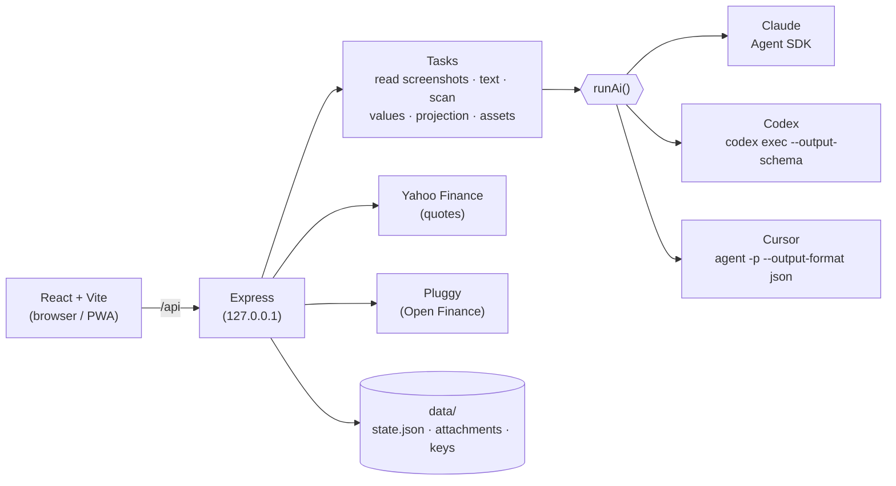

<div align="center">

# 🏛️ Arca Assistant

**English** · [Português](README.pt-BR.md)

### Your whole net worth in one place — organized by the **Arca** method, with AI that reads your bank screenshots, researches the market and projects the future.

**Claude · Codex (ChatGPT) · Cursor** — with the login you already have, or an API key.
Self-hosted: runs 100% on your computer. Your data never leaves it (it only goes to the AI you pick, at the moment of each analysis).

<br/>


<br/>


<sub>Demo with 100% fictional data (<code>npm run demo</code>). <a href="docs/demo.mp4">Video version (MP4)</a></sub>

</div>

---

**Arca Assistant** is a self-hosted, AI-powered **personal finance and investment portfolio tracker** built for Brazilian investors (and anyone who likes the **Arca** asset allocation). It consolidates stocks, REITs (FIIs), fixed income (CDB, LCI, Tesouro Direto), international ETFs, crypto and physical assets across banks and brokers, **rebalances** to your target allocation, and runs **AI market research and long-term projections**. Bring your own AI: **Claude Code, OpenAI Codex (ChatGPT) or Cursor**.

> **The Arca method** (popularized by Thiago Nigro, *Primo Rico*) splits a portfolio equally into four "pillars": **Stocks · Real estate (FIIs) · Cash / Fixed income · International** (25/25/25/25). The app also ships the *Arca Grão* split (30/10/40/20) or your own custom targets.

## ✨ Features

| | |
|---|---|
| 📸 **Import anything** | Bank app screenshots, PDFs, CSV/XLSX statements (BTG, XP, Nubank, Itaú, Inter…) or a sentence: *"17000.30 added to the cdb box at inter pj"*. The AI extracts, classifies and **asks when it isn't sure**. |
| 🎬 **Screen recordings** | Record your screen scrolling the bank app instead of taking ten screenshots. The app picks **one frame per screen** (skipping scroll blur and repeats) and the AI reads them like screenshots. MP4, MOV, WEBM… |
| 🏦 **Open Finance** | Connect your banks through [Meu Pluggy](https://meu.pluggy.ai) (free for personal use) and pull investments straight from the source — fixed income, stocks, FIIs, ETFs, funds, pension plans — already classified into the Arca. It can be the **source of truth**: it replaces what you had at that institution and feeds *Update values*. |
| 🌐 **English and Portuguese** | The whole UI in both languages (switch in Settings or in the menu footer). The AI writes scans, projections and questions in the chosen language. |
| 💱 **Real & US dollar** | Each position keeps its own currency (BRL or USD); totals, charts, rebalancing and projection can be shown in **reais or dollars** (Settings → Currency). Exchange rates refresh automatically, and the currency registry is ready for more (EUR, GBP…). |
| 📱 **Mobile-first PWA** | Designed for iPhone and Android (tab bar, bottom sheets, no zoom on inputs) and **installable on the home screen**. Reach it away from home through Tailscale, without exposing anything to the internet. |
| 👁️ **Hide values** | The eye next to *Net worth* masks every amount (R$ •••••) across the app. Percentages and the charts stay, so you can open it in public. Remembered per device. |
| 🧠 **Understands file names** | `itau-pf-cdb100cdi.png` → Itaú · individual (PF) · CDB at 100% of CDI. The AI double-checks it. |
| 🔁 **Duplicate detection** | Identical files (SHA-256), near-identical screenshots (perceptual hash) and the same screen in different screenshots (the AI compares the content). |
| 🏛️ **Arca portfolio** | Stocks · Real estate (FIIs) · Cash / Fixed income · International — Arca (25/25/25/25), Arca Grão (30/10/40/20) or your own split. Click a class to see its assets. Crypto can count as **International** or stay **Outside the Arca** (a checkbox in Settings). |
| 👥 **Individual & company (PF / PJ)** | Consolidated or per-owner view on every screen, including the projection. |
| ⚖️ **Rebalancing** | How much to contribute to each class (or sell) to get back on target, and where to put the money. |
| 📊 **Market** | How your main holdings are doing **today** (price, daily change, intraday chart, estimated impact on your wealth) next to Ibovespa, IFIX, S&P 500, USD/BRL and Bitcoin, with a refresh button. **Search any asset** (B3, US, ETFs, crypto) and run a **full AI research**: financials, quality score, expected rise or fall, macro and geopolitics, positive and negative scenarios, and a recommendation (buy, accumulate, hold, reduce, avoid) based on **your portfolio and the Arca**. Research is saved. |
| 🔎 **AI asset scan** | The AI researches balance sheets, FII reports, Brazil's fiscal situation and ETFs, and returns a ranking with thesis, metrics, risks and sources. |
| 🔄 **Update values** | Stocks, FIIs, ETFs, USD and crypto by market quote; fixed income estimated by the AI accruing CDI/Selic/IPCA; Open Finance institutions straight from the bank. You review before applying. |
| 📈 **5–30 year projection** | Likely and plausible worst-case scenarios, with researched assumptions (Focus survey, rates, fiscal, valuation) and the math done by the app — nominal and in today's money. |
| 🏦 **By institution** | How much you hold at each bank/broker. Mark one as outdated and the app reminds you to update it. |
| 🚗 **Physical assets** | Cars, real estate, jewelry and electronics outside the portfolio, with **AI value estimates** (FIPE table, new and used listings, gold price) and attachments (photos, invoices). |
| ⏰ **Reminders** | Outdated institutions on startup and a periodic "is everything up to date?" check every 1 or 2 weeks. |

<div align="center">


</div>

<sub>Screenshots show the Portuguese UI; switch to English in Settings → Language.</sub>

---

## 🚀 Getting started

**Requirements:** Node.js 20+ and **one** of the AIs below.

### 🤖 Install with your AI (copy & paste)

Open **Claude Code**, **Codex** or the **Cursor** agent in an empty folder and paste:

```text
Install Arca Assistant (https://github.com/isacsneto/arca-assistant) on this computer and keep it running for me:
1. Check that Node.js 20+ and git are installed; if not, tell me how to install them on my OS and wait.
2. Clone the repository into a folder (default: ~/arca-assistant) and run "npm install".
3. Check whether an AI is ready: Claude Code ("claude auth status"), Codex ("npx codex login status") or Cursor ("agent status"). If none is logged in, ask which one I want and guide me through the login (I will run interactive logins myself).
4. Ask whether I want the app to start automatically with the computer. If yes, run "npm run local:install" (Windows, macOS or Linux) and show me the address it prints; if not, run "npm run local".
5. If Tailscale is installed, check that the https://….ts.net address opens; if "tailscale serve" asks to enable HTTPS, show me the link.
6. Open http://localhost:3001 and tell me to pick the language and the AI provider in Settings.
Do not put my financial data, passwords or API keys in commands or files (I enter those myself in the app's Settings screen). Do not expose the app to the internet: no port forwarding and no Tailscale Funnel.
```

### ⌨️ Or by hand

```bash
git clone https://github.com/isacsneto/arca-assistant.git
cd arca-assistant
npm install
npm run dev          # opens http://localhost:5173
```

Want to try it before adding your data? Run the demo with a fictional portfolio (port 3101, separate data):

```bash
npm run demo         # npm run demo:reset recreates the fictional data
```

### 🤖 Choose your AI

In **Settings → AI provider** you pick the provider and the access mode. The app shows whether each one is installed, logged in and has a key.

| Provider | 🔐 Local login (uses your subscription) | 🔑 API key |
|---|---|---|
| **Claude** (Anthropic) | `claude auth login` — the Claude Code engine ships with the app | `ANTHROPIC_API_KEY` |
| **Codex** (OpenAI / ChatGPT) | `npx codex login` — the Codex CLI ships with the app | `CODEX_API_KEY` or `OPENAI_API_KEY` |
| **Cursor** | install the [Cursor CLI](https://cursor.com/docs/cli/installation) and run `agent login` | `CURSOR_API_KEY` (needs the CLI) |

- Keys can be entered in the UI (stored only in `data/secrets.json`, outside git, and **never sent to the browser**) or via environment variables.
- With Claude you pick the model per task (Opus for long research, Sonnet for reading…). With Codex and Cursor, a **strong** model (scan and projection) and a **fast** one (everything else) — blank uses the CLI default.
- Reasoning effort is adjustable per task for all of them.
- The app's language (**Settings → Language**) also sets the language the AI writes in.

### 🖥️ Keep it running on your computer (free)

The cheapest option is your own computer: zero cost, the AI uses the login you already have (no API key to pay for) and your data never leaves your machine.

```bash
npm run local:install    # starts on every login (Windows, macOS or Linux) + Tailscale access
npm run local:stop       # stop now (comes back on next login; local:install starts it again)
npm run local:uninstall  # removes auto-start and tailscale serve
npm run local            # foreground, restarting if it crashes (installs nothing)
```

`local:install` builds the app and starts the server at `http://localhost:3001`, with no window at all. If the server crashes it is back in seconds; if it hangs (alive but not answering for ~2 min) it is restarted; and if the supervisor itself exits, the OS service brings it back. Only one instance runs at a time, since two writing the same `data/` would overwrite each other. Logs live in `data/logs/server.log`.

| OS | What `local:install` creates | Notes |
|---|---|---|
| **Windows** | Task Scheduler task **"Arca Assistant"** at logon (`conhost --headless`: no window to close by accident) | Run it in PowerShell. No admin needed. |
| **macOS** | LaunchAgent `~/Library/LaunchAgents/com.arca-assistant.plist` (`RunAtLoad` + `KeepAlive`, always restarts) | Works with the Tailscale Mac app or CLI. |
| **Linux** | systemd user service `~/.config/systemd/user/arca-assistant.service` (`Restart=always`) | The installer turns on *linger* so the app keeps running after you log out; without permission, run `sudo loginctl enable-linger $USER`. If `tailscale serve` refuses: `sudo tailscale set --operator=$USER`. |

Services run as **your user**, so the AI uses the Claude or Codex login you already did in the terminal.

**Good to know**

- The computer must be on (and, on Windows and macOS, logged in). If it sleeps, the app is offline until it wakes; disable automatic sleep if you want access all the time.
- After a `git pull`, run `npm run local:stop` and `npm run local:install`: the app rebuilds on start.
- To develop with `npm run dev`, run `npm run local:stop` first (both use port 3001).

### 📱 Access from your phone with Tailscale

[Tailscale](https://tailscale.com/download) creates a private network between your devices (free for personal use). The app keeps listening only on `127.0.0.1`; Tailscale serves the address **only to devices signed in to your account**.

1. Install Tailscale on the computer running the app and sign in (Google, Microsoft, Apple or GitHub).
2. Run `npm run local:install`. It configures `tailscale serve` with HTTPS and prints the address, something like `https://my-pc.tail1234.ts.net`.
   - The first time, Tailscale may ask you to **enable HTTPS/Serve on your tailnet**: open the link it prints, confirm and run the command again.
   - The first visit can take up to a minute while the certificate is issued.
3. On your phone, install the **Tailscale** app ([iPhone](https://apps.apple.com/app/tailscale/id1470499037) · [Android](https://play.google.com/store/apps/details?id=com.tailscale.ipn)), sign in with the **same account** and keep the VPN on.
4. Open the `https://….ts.net` address in your phone's browser.

**Install it as an app on your home screen**

- **iPhone (Safari):** open the address → **Share** button → **Add to Home Screen** → **Add**. Arca opens full screen, with its own icon, a bottom tab bar and respecting the Dynamic Island.
- **Android (Chrome):** open the address → **⋮** menu → **Install app** (or **Add to home screen**).

The installed app is just a shortcut to your server: with the Tailscale VPN off, or the computer off, it won't open.

> 🔒 **Don't expose the app to the internet** (router port forwarding, Tailscale Funnel, public tunnels): it has no login screen, and anyone who reaches it sees your portfolio. `tailscale serve` is different from Funnel: only your tailnet can see it.

Hosts like Vercel, Netlify or free Render don't work: they wipe saved files, can't run the AI CLIs and cut long tasks. If you want it 24/7 without depending on your computer, use a small VPS (or Oracle Cloud's free VM), run `npm run local:install` there (Linux) and reach it through Tailscale the same way.

### 🏦 Open Finance (optional, Brazil)

1. Create an account at [meu.pluggy.ai](https://meu.pluggy.ai) and connect your banks (authorization happens in each bank's app).
2. In **Settings → Open Finance**, paste your application's **Client ID** and **Client Secret** (the app verifies them with Pluggy before saving).
3. Click **Find connections** (or paste each bank's `itemId`) and mark each one as PF or PJ.
4. **Import → Open Finance → Fetch investments**: review and save.

With **"Use Open Finance as the source of truth"** on (default), each connection mirrors the bank **within its exact scope: institution + owner**:

- **on import**, what you had at that institution and owner is replaced by what came from Open Finance;
- in the Portfolio's **Update values**, that scope's values come from Pluggy instead of quotes or the AI. New assets show up to be added and missing ones to be removed. You review before applying.
- **Nothing outside the scope is touched.** Example: a **BTG PF** connection replaces and updates only BTG PF. **BTG PJ** stays intact (with values from screenshots, text, quotes or the AI) unless you also have a **BTG PJ** connection returning data. A failing connection changes nothing in its scope.

Meu Pluggy's free plan covers up to 5 connections of the same owner, refreshed every 24 h. Brokers outside Brazil aren't part of Open Finance; for those, use screenshots, video or text. Credentials stay on the server only (`data/secrets.json` or `PLUGGY_CLIENT_ID` / `PLUGGY_CLIENT_SECRET`).

---

## 🧩 How it works



- **One AI interface, three engines.** Each task asks for *instructions + task + JSON schema + attachments + web search*; each provider's engine translates that (native structured output on Claude and Codex; validated JSON with a retry on Cursor).
- **The app does the math, not the model.** The AI sets assumptions and reads documents; rebalancing, projection, value accrual and validations (negative balances, duplicates, lost items) are computed in tested code.
- **You review before saving.** Imports, value updates and text operations always show before → after.

### 📁 Tip: name your files

`<institution>-<pf|pj>[-<product>]` — e.g. `vest-pf.png`, `btg-pj.pdf`, `itau-pf-cdb100cdi.jpg`, `xp_pj_lci95.png`. Versions and copies (`v2`, `copy`, `(2)`, dates) are ignored.

---

## 🔒 Privacy & security

- The server listens **only on `127.0.0.1`**: nobody on your network can reach your portfolio.
- Everything lives in `data/` (outside git): portfolio, asset attachments and API keys.
- Uploaded files go to the chosen AI at analysis time; import screenshots aren't stored.
- Each AI call is isolated: no access to your other projects, read-only, and only the tools it needs (read attachments, web search).
- Links coming from the web are filtered (`http/https` only); attachments get server-generated names (no path traversal).

---

## 🛠️ Development

```bash
npm test             # 170 tests (node:test + tsx)
npm run typecheck
npm run build && npm start   # local production at http://localhost:3001
API_PORT=3101 npx vite       # front-end against another instance (e.g. the demo)
```

```
shared/   rules and types (Arca, projection, import, duplicates, PF/PJ, AI, Open Finance, i18n, currencies) — tested
server/   Express, AI tasks (tasks.ts), engines in server/ai/, quotes, Pluggy, video, attachments
src/      React: Portfolio, Rebalance, Projection, Institutions, Assets, Import, Scan…
scripts/  demo with a fictional portfolio, local.mjs (always on) and per-OS services (windows/, unix/)
```

**Adding a currency:** add one entry to `CURRENCIES` in `shared/currency.ts` (symbol, name, fallback rate). Its exchange rate is fetched automatically (Yahoo `EURBRL=X`, AwesomeAPI `EUR-BRL`), and it shows up in the selectors, in the AI import schema and in Open Finance. Totals are computed in the base currency (BRL) and converted for display.

`ARCA_DATA_DIR` points to another data folder (that's how the demo runs without touching your data). UI strings are written in both languages in place: `L("Carteira", "Portfolio")` (see `shared/i18n.ts`).

---

## 📄 License

[MIT](LICENSE) © 2026 Isac Santos — use, modify and share freely, keeping the copyright notice. The software is provided "as is", without warranty.

Dependencies keep their own licenses: `ffmpeg-static` (GPL-3.0, downloaded by npm at install time, used only to read videos the browser can't open) and the Claude Agent SDK (Anthropic's terms, which each user accepts when using Claude).

---

<sub>
⚠️ <b>Disclaimer:</b> Arca Assistant is a personal organization tool. Analyses, scans, estimates and projections are AI-generated from public data and may contain errors — <b>they are not investment advice</b>. Check the sources before deciding.
"Arca" is the method popularized by Thiago Nigro (Primo Rico); this project is not affiliated with him, Grupo Primo or any institution mentioned.
</sub>
