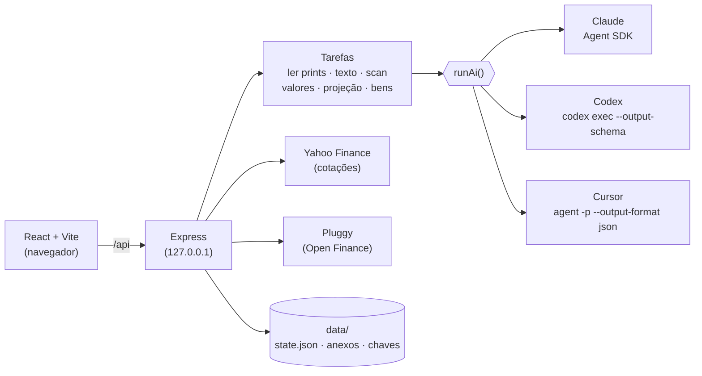

<div align="center">

# 🏛️ Arca Assistant

### Seu patrimônio inteiro num lugar só — organizado pela filosofia **Arca**, com IA que lê seus prints, pesquisa o mercado e projeta o futuro.

**Claude · Codex (ChatGPT) · Cursor** — com o login que você já tem ou com chave de API.
Roda 100% no seu computador. Seus dados não saem dele (só vão para a IA que você escolher, na hora de cada análise).

<br/>


<br/>


<sub>Demonstração com dados 100% fictícios (<code>npm run demo</code>). <a href="docs/demo.mp4">Versão em vídeo (MP4)</a></sub>

</div>

---

## ✨ O que ele faz

| | |
|---|---|
| 📸 **Importa qualquer coisa** | Prints do app do banco, PDFs, CSV/XLSX (BTG, XP, Nubank, Itaú, Inter…) ou uma frase: *"17000.30 adicionados à caixinha cdb do inter pj"*. A IA extrai, classifica e **pergunta quando não tem certeza**. |
| 🎬 **Vídeo de tela** | Grave a tela rolando o app do banco em vez de tirar dez prints. O app escolhe **um quadro por tela** (descarta o borrão da rolagem e as repetições) e a IA lê como prints. MP4, MOV, WEBM… |
| 🏦 **Open Finance** | Conecte seus bancos pelo [Meu Pluggy](https://meu.pluggy.ai) (grátis para uso pessoal) e puxe os investimentos direto da fonte — renda fixa, ações, FIIs, ETFs, fundos, previdência — já classificados na Arca. Pode ser a **fonte da verdade**: substitui o que havia na instituição e alimenta o *Atualizar valores*. |
| 📱 **No celular** | Interface feita para iPhone e Android (barra de abas, folhas que sobem de baixo, campos sem zoom) e **instalável na tela inicial**. Acesso de fora de casa pelo Tailscale, sem expor nada na internet. |
| 🧠 **Entende o nome do arquivo** | `itau-pf-cdb100cdi.png` → Itaú · pessoa física · CDB 100% do CDI. A IA confere a leitura. |
| 🔁 **Detecta duplicados** | Arquivo idêntico (SHA-256), print quase igual (hash visual) e mesma tela em prints diferentes (a IA compara o conteúdo). |
| 🏛️ **Carteira pela Arca** | Ações · Imóveis (FIIs) · Caixa/Renda Fixa · Internacional — Arca do Primo Rico (25/25/25/25), Arca Grão (30/10/40/20) ou sua própria divisão. Clique numa classe e veja os ativos. |
| 👥 **PF e PJ** | Visão consolidada ou separada por titular em todas as telas, inclusive na projeção. |
| ⚖️ **Rebalanceamento** | Diz quanto aportar em cada classe (ou quanto vender) para voltar às metas, e onde colocar o dinheiro. |
| 🔎 **Scan de ativos** | A IA pesquisa balanços, relatórios de FIIs, a situação fiscal do governo e ETFs, e devolve um ranking com tese, métricas, riscos e fontes. |
| 🔄 **Atualizar valores** | Ações, FIIs, ETFs, dólar e cripto pela cotação de mercado; renda fixa estimada pela IA acumulando CDI/Selic/IPCA; instituições conectadas ao Open Finance, direto do banco. Você revisa antes de aplicar. |
| 📈 **Projeção 5–30 anos** | Cenário mais provável e pior caso plausível, com premissas pesquisadas (Focus, juros, fiscal, valuation) e a conta feita pelo app — nominal e em reais de hoje. |
| 🏦 **Por instituição** | Quanto você tem em cada banco/corretora. Marque uma como desatualizada e o app lembra você de atualizar. |
| 🚗 **Bens físicos** | Carros, imóveis, joias e eletrônicos fora dos investimentos, com **estimativa de valor por IA** (FIPE, anúncios de novos e usados, cotação do ouro) e anexos (fotos, nota fiscal). |
| ⏰ **Lembretes** | Instituições desatualizadas ao abrir o app e revisão periódica ("está tudo atualizado?") a cada 1 ou 2 semanas. |

<div align="center">


</div>

---

## 🚀 Começando

**Requisitos:** Node.js 20+ e **uma** das IAs abaixo.

```bash
git clone https://github.com/isacsneto/arca-assistant.git
cd arca-assistant
npm install
npm run dev          # abre em http://localhost:5173
```

Quer ver antes de colocar seus dados? Rode a demonstração com uma carteira fictícia (porta 3101, dados separados):

```bash
npm run demo         # npm run demo:reset recria os dados fictícios
```

### 🤖 Escolha sua IA

Em **Ajustes → Provedor de IA** você escolhe o provedor e o modo de acesso. O app mostra se cada um está instalado, logado e com chave.

| Provedor | 🔐 Login local (usa sua assinatura) | 🔑 Chave de API |
|---|---|---|
| **Claude** (Anthropic) | `claude auth login` — o motor do Claude Code já vem no app | `ANTHROPIC_API_KEY` |
| **Codex** (OpenAI / ChatGPT) | `npx codex login` — o Codex CLI já vem no app | `CODEX_API_KEY` ou `OPENAI_API_KEY` |
| **Cursor** | instale o [Cursor CLI](https://cursor.com/docs/cli/installation) e rode `agent login` | `CURSOR_API_KEY` (precisa do CLI) |

- Chaves podem ser cadastradas pela tela (ficam só em `data/secrets.json`, fora do git, e **nunca vão para o navegador**) ou por variável de ambiente.
- No Claude você escolhe o modelo de cada tarefa (Opus para pesquisas longas, Sonnet para leitura…). No Codex e no Cursor, um modelo **forte** (scan e projeção) e um **rápido** (o resto) — em branco usa o padrão do CLI.
- O esforço de raciocínio é ajustável por tarefa em todos.

### 🖥️ Deixar rodando sozinho no seu computador (grátis)

A opção mais barata é o seu próprio computador: custo zero, a IA usa o login que você já tem (sem pagar chave de API) e os dados não saem da sua máquina.

```bash
npm run local:install    # sobe sozinho a cada login (Windows, macOS ou Linux) + acesso pelo Tailscale
npm run local:stop       # para agora (volta no próximo login; local:install religa)
npm run local:uninstall  # remove a inicialização automática e o tailscale serve
npm run local            # roda em primeiro plano, reiniciando se cair (sem instalar nada)
```

O `local:install` compila o app, sobe o servidor em `http://localhost:3001` e reinicia se ele cair. Só uma instância roda por vez, porque duas gravando o mesmo `data/` se sobrescreveriam. Os logs ficam em `data/logs/server.log`.

| Sistema | O que o `local:install` cria | Observações |
|---|---|---|
| **Windows** | Tarefa **"Arca Assistant"** no Agendador, ao fazer login (janela oculta) | Rode no PowerShell, sem `!` na frente. Não precisa ser administrador. |
| **macOS** | LaunchAgent `~/Library/LaunchAgents/com.arca-assistant.plist` (`RunAtLoad` + `KeepAlive`) | Usa o Tailscale do app da Mac App Store ou o CLI. |
| **Linux** | Serviço systemd do usuário `~/.config/systemd/user/arca-assistant.service` | Para rodar mesmo sem você logado: `sudo loginctl enable-linger $USER`. Se o `tailscale serve` recusar: `sudo tailscale set --operator=$USER`. |

Os serviços rodam com o **seu usuário**, para a IA usar o login local do Claude ou do Codex que você já fez no terminal.

**Bom saber**

- O computador precisa estar ligado (e, no Windows e no macOS, com você logado). Se ele dormir, o app fica fora do ar até acordar; desative a suspensão automática se quiser acesso o tempo todo.
- Depois de um `git pull`, rode `npm run local:stop` e `npm run local:install`: o app recompila ao subir.
- Para desenvolver com `npm run dev`, rode antes `npm run local:stop` (os dois usam a porta 3001).

### 📱 Acessar pelo celular com o Tailscale

O [Tailscale](https://tailscale.com/download) cria uma rede privada entre os seus aparelhos (grátis para uso pessoal). O app continua escutando só em `127.0.0.1`; o Tailscale entrega o endereço **apenas para os aparelhos logados na sua conta**.

1. Instale o Tailscale no computador que roda o app e entre com a sua conta (Google, Microsoft, Apple ou GitHub).
2. Rode `npm run local:install`. Ele configura o `tailscale serve` com HTTPS e mostra o endereço, algo como `https://meu-pc.tail1234.ts.net`.
   - Na primeira vez o Tailscale pode pedir para **habilitar HTTPS/Serve na sua rede**: abra o link que aparecer, confirme e rode o comando de novo.
   - O primeiro acesso pode levar até um minuto, enquanto o certificado é emitido.
3. No celular, instale o app **Tailscale** ([iPhone](https://apps.apple.com/app/tailscale/id1470499037) · [Android](https://play.google.com/store/apps/details?id=com.tailscale.ipn)), entre com a **mesma conta** e deixe a VPN ligada.
4. Abra o endereço `https://….ts.net` no navegador do celular.

**Instalar como app na tela inicial**

- **iPhone (Safari):** abra o endereço → botão **Compartilhar** → **Adicionar à Tela de Início** → **Adicionar**. O Arca abre em tela cheia, com ícone próprio, barra de abas embaixo e respeitando a Dynamic Island.
- **Android (Chrome):** abra o endereço → menu **⋮** → **Instalar app** (ou **Adicionar à tela inicial**).

O app instalado é só um atalho para o seu servidor: com a VPN do Tailscale desligada, ou o computador desligado, ele não abre.

> 🔒 **Não exponha o app na internet** (porta aberta no roteador, Tailscale Funnel, túnel público): ele não tem tela de login, e quem acessar vê sua carteira. O `tailscale serve` é diferente do Funnel: só a sua rede enxerga.

Hospedagens como Vercel, Netlify e Render grátis não servem: apagam os arquivos salvos, não rodam os CLIs de IA e cortam tarefas longas. Se quiser o app 24 h sem depender do seu computador, use uma VPS pequena (ou a VM grátis da Oracle Cloud), rode o `npm run local:install` lá (Linux) e acesse pelo Tailscale do mesmo jeito.

### 🏦 Open Finance (opcional)

1. Crie a conta em [meu.pluggy.ai](https://meu.pluggy.ai) e conecte seus bancos (a autorização é feita no app de cada banco).
2. Em **Ajustes → Open Finance**, cole o **Client ID** e o **Client Secret** da sua aplicação (o app confere com a Pluggy antes de salvar).
3. Clique em **Buscar conexões** (ou cole o `itemId` de cada banco) e marque se cada uma é PF ou PJ.
4. **Importar → Open Finance → Buscar investimentos**: revise e salve.

Com **"Usar o Open Finance como fonte da verdade"** ligado (padrão), cada conexão passa a ser espelho do banco **no seu escopo exato: instituição + titular**:

- **ao importar**, o que você tinha naquela instituição e titular é substituído pelo que veio do Open Finance;
- no **Atualizar valores** da Carteira, os valores daquele escopo vêm da Pluggy, e não da cotação nem da IA. Ativos novos aparecem para entrar e os que sumiram aparecem para sair. Você revisa antes de aplicar.
- **Nada fora do escopo é tocado.** Exemplo: uma conexão **BTG PF** substitui e atualiza só o BTG PF. O **BTG PJ** continua intacto (com valores de print, texto, cotação ou IA), a não ser que você tenha também uma conexão **BTG PJ** trazendo dados. Uma conexão com erro não muda nada no escopo dela.

O plano gratuito do Meu Pluggy cobre até 5 conexões do mesmo titular, atualizadas a cada 24 h. Corretoras de fora do Brasil não fazem parte do Open Finance; para elas, use print, vídeo ou texto. As credenciais ficam só no servidor (`data/secrets.json` ou `PLUGGY_CLIENT_ID` / `PLUGGY_CLIENT_SECRET`).

---

## 🧩 Como funciona



- **Uma interface de IA, três motores.** Cada tarefa pede *instruções + tarefa + schema JSON + anexos + busca na web*; o motor do provedor traduz isso (saída estruturada nativa no Claude e no Codex; JSON validado com nova tentativa no Cursor).
- **A conta é do app, não do modelo.** A IA define premissas e lê documentos; rebalanceamento, projeção, acúmulo de valores e validações (saldo negativo, duplicados, itens perdidos) são calculados em código testado.
- **Você revisa antes de salvar.** Importações, atualizações de valor e operações por texto sempre mostram antes → depois.

### 📁 Dica: nomeie seus arquivos

`<instituição>-<pf|pj>[-<produto>]` — por exemplo `vest-pf.png`, `btg-pj.pdf`, `itau-pf-cdb100cdi.jpg`, `xp_pj_lci95.png`. Versões e cópias (`v2`, `copia`, `(2)`, datas) são ignoradas.

---

## 🔒 Privacidade e segurança

- O servidor escuta **só em `127.0.0.1`**: ninguém na sua rede acessa sua carteira.
- Tudo fica em `data/` (fora do git): carteira, anexos dos bens e chaves de API.
- Arquivos enviados vão para a IA escolhida na hora da análise; prints de importação não são guardados.
- Cada chamada de IA é isolada: sem acesso aos seus outros projetos, em modo somente leitura e só com as ferramentas necessárias (ler os anexos, buscar na web).
- Links vindos da web são filtrados (só `http/https`); anexos têm nomes gerados pelo servidor (sem path traversal).

---

## 🛠️ Desenvolvimento

```bash
npm test             # 147 testes (node:test + tsx)
npm run typecheck
npm run build && npm start   # produção local em http://localhost:3001
```

```
shared/   regras e tipos (Arca, projeção, importação, duplicados, PF/PJ, IA) — testados
server/   Express, tarefas de IA (tasks.ts), motores em server/ai/, cotações, anexos
src/      React: Carteira, Rebalancear, Projeção, Instituições, Bens, Importar, Scan…
scripts/  demo com carteira fictícia, local.mjs (rodar sempre) e serviços por sistema (windows/, unix/)
```

`ARCA_DATA_DIR` aponta para outra pasta de dados (é assim que a demo roda sem tocar nos seus dados).

---

<sub>
⚠️ <b>Aviso:</b> o Arca Assistant é uma ferramenta pessoal de organização. Análises, scans, estimativas e projeções são gerados por IA a partir de dados públicos e podem conter erros — <b>não são recomendação de investimento</b>. Confira as fontes antes de decidir.
A "Arca" é a metodologia divulgada por Thiago Nigro (Primo Rico); este projeto não tem relação com ele, com o Grupo Primo nem com as instituições citadas.
</sub>
