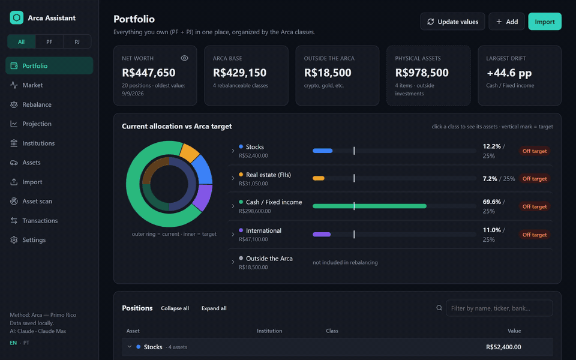
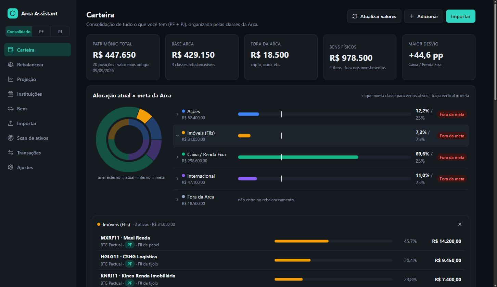
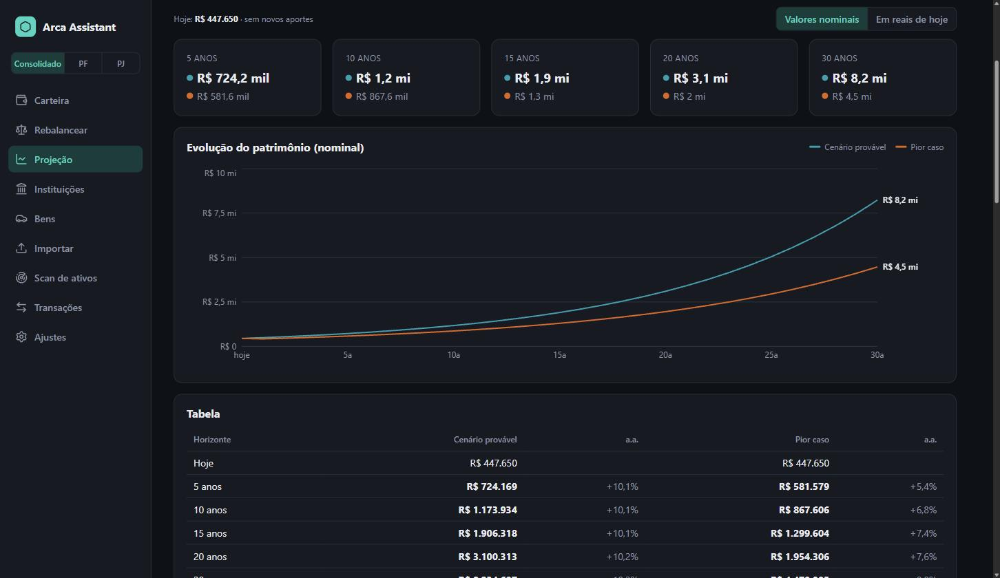
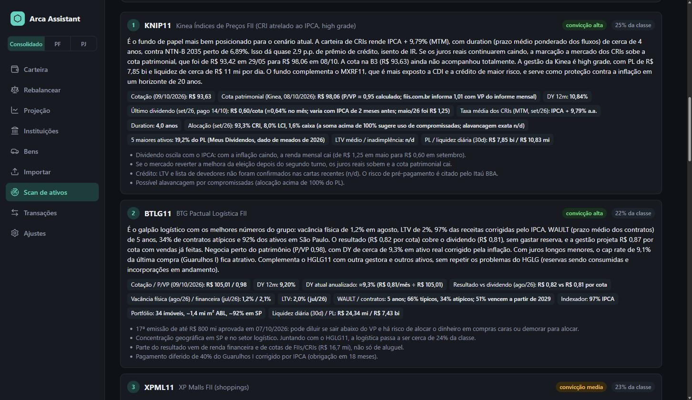
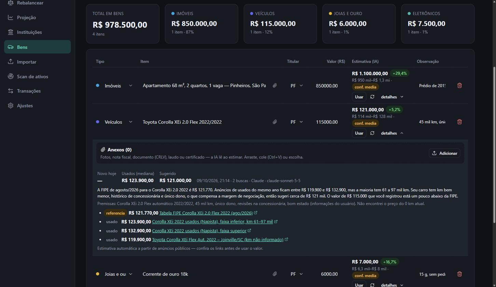
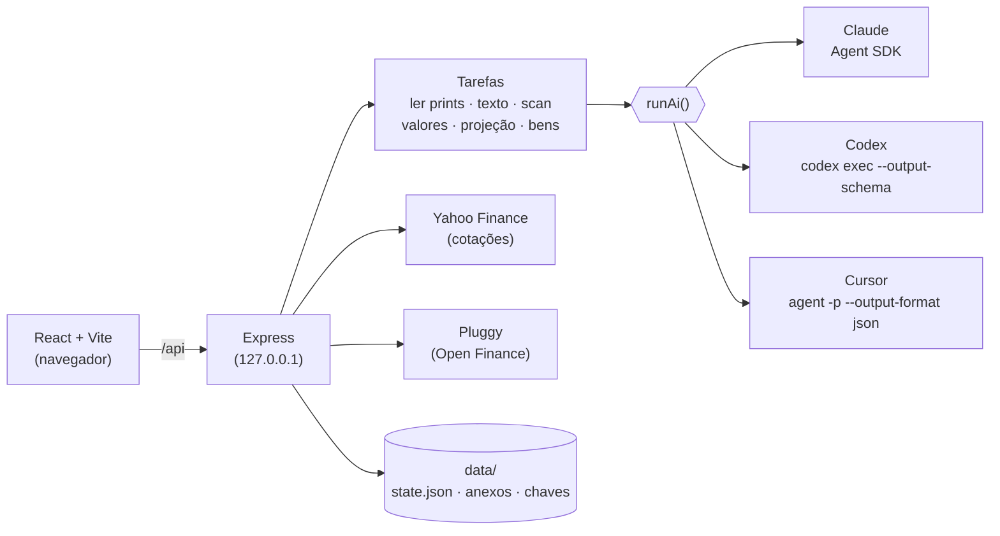

<div align="center">

# 🏛️ Arca Assistant

### Seu patrimônio inteiro num lugar só — organizado pela filosofia **Arca**, com IA que lê seus prints, pesquisa o mercado e projeta o futuro.

**Claude · Codex (ChatGPT) · Cursor** — com o login que você já tem ou com chave de API.
Roda 100% no seu computador. Seus dados não saem dele (só vão para a IA que você escolher, na hora de cada análise).

<br/>


<br/>



<sub>Demonstração com dados 100% fictícios (<code>npm run demo</code>). <a href="docs/demo.mp4">Versão em vídeo (MP4)</a></sub>

</div>

---

## ✨ O que ele faz

| | |
|---|---|
| 📸 **Importa qualquer coisa** | Prints do app do banco, PDFs, CSV/XLSX (BTG, XP, Nubank, Itaú, Inter…) ou uma frase: *"17000.30 adicionados à caixinha cdb do inter pj"*. A IA extrai, classifica e **pergunta quando não tem certeza**. |
| 🎬 **Vídeo de tela** | Grave a tela rolando o app do banco em vez de tirar dez prints. O app escolhe **um quadro por tela** (descarta o borrão da rolagem e as repetições) e a IA lê como prints. MP4, MOV, WEBM… |
| 🏦 **Open Finance** | Conecte seus bancos pelo [Meu Pluggy](https://meu.pluggy.ai) (grátis para uso pessoal) e puxe os investimentos direto da fonte — renda fixa, ações, FIIs, ETFs, fundos, previdência — já classificados na Arca e revisados por você antes de salvar. |
| 🧠 **Entende o nome do arquivo** | `itau-pf-cdb100cdi.png` → Itaú · pessoa física · CDB 100% do CDI. A IA confere a leitura. |
| 🔁 **Detecta duplicados** | Arquivo idêntico (SHA-256), print quase igual (hash visual) e mesma tela em prints diferentes (a IA compara o conteúdo). |
| 🏛️ **Carteira pela Arca** | Ações · Imóveis (FIIs) · Caixa/Renda Fixa · Internacional — Arca do Primo Rico (25/25/25/25), Arca Grão (30/10/40/20) ou sua própria divisão. Clique numa classe e veja os ativos. |
| 👥 **PF e PJ** | Visão consolidada ou separada por titular em todas as telas, inclusive na projeção. |
| ⚖️ **Rebalanceamento** | Diz quanto aportar em cada classe (ou quanto vender) para voltar às metas, e onde colocar o dinheiro. |
| 🔎 **Scan de ativos** | A IA pesquisa balanços, relatórios de FIIs, a situação fiscal do governo e ETFs, e devolve um ranking com tese, métricas, riscos e fontes. |
| 🔄 **Atualizar valores** | Ações, FIIs, ETFs, dólar e cripto pela cotação de mercado; renda fixa estimada pela IA acumulando CDI/Selic/IPCA. Você revisa antes de aplicar. |
| 📈 **Projeção 5–30 anos** | Cenário mais provável e pior caso plausível, com premissas pesquisadas (Focus, juros, fiscal, valuation) e a conta feita pelo app — nominal e em reais de hoje. |
| 🏦 **Por instituição** | Quanto você tem em cada banco/corretora. Marque uma como desatualizada e o app lembra você de atualizar. |
| 🚗 **Bens físicos** | Carros, imóveis, joias e eletrônicos fora dos investimentos, com **estimativa de valor por IA** (FIPE, anúncios de novos e usados, cotação do ouro) e anexos (fotos, nota fiscal). |
| ⏰ **Lembretes** | Instituições desatualizadas ao abrir o app e revisão periódica ("está tudo atualizado?") a cada 1 ou 2 semanas. |

<div align="center">




</div>

---

## 🚀 Começando

**Requisitos:** Node.js 20+ e **uma** das IAs abaixo.

```bash
git clone https://github.com/isacsneto/arca-assistant.git
cd arca-assistant
npm install
npm run dev          # abre em http://localhost:5173
```

Quer ver antes de colocar seus dados? Rode a demonstração com uma carteira fictícia (porta 3101, dados separados):

```bash
npm run demo         # npm run demo:reset recria os dados fictícios
```

### 🤖 Escolha sua IA

Em **Ajustes → Provedor de IA** você escolhe o provedor e o modo de acesso. O app mostra se cada um está instalado, logado e com chave.

| Provedor | 🔐 Login local (usa sua assinatura) | 🔑 Chave de API |
|---|---|---|
| **Claude** (Anthropic) | `claude auth login` — o motor do Claude Code já vem no app | `ANTHROPIC_API_KEY` |
| **Codex** (OpenAI / ChatGPT) | `npx codex login` — o Codex CLI já vem no app | `CODEX_API_KEY` ou `OPENAI_API_KEY` |
| **Cursor** | instale o [Cursor CLI](https://cursor.com/docs/cli/installation) e rode `agent login` | `CURSOR_API_KEY` (precisa do CLI) |

- Chaves podem ser cadastradas pela tela (ficam só em `data/secrets.json`, fora do git, e **nunca vão para o navegador**) ou por variável de ambiente.
- No Claude você escolhe o modelo de cada tarefa (Opus para pesquisas longas, Sonnet para leitura…). No Codex e no Cursor, um modelo **forte** (scan e projeção) e um **rápido** (o resto) — em branco usa o padrão do CLI.
- O esforço de raciocínio é ajustável por tarefa em todos.

### 🏦 Open Finance (opcional)

1. Crie a conta em [meu.pluggy.ai](https://meu.pluggy.ai) e conecte seus bancos (a autorização é feita no app de cada banco).
2. Em **Ajustes → Open Finance**, cole o **Client ID** e o **Client Secret** da sua aplicação (o app confere com a Pluggy antes de salvar).
3. Clique em **Buscar conexões** (ou cole o `itemId` de cada banco) e marque se cada uma é PF ou PJ.
4. **Importar → Open Finance → Buscar investimentos**: revise e salve.

O plano gratuito do Meu Pluggy cobre até 5 conexões do mesmo titular, atualizadas a cada 24 h. Corretoras de fora do Brasil não fazem parte do Open Finance — para elas, use print, vídeo ou texto. As credenciais ficam só no servidor (`data/secrets.json` ou `PLUGGY_CLIENT_ID` / `PLUGGY_CLIENT_SECRET`).

---

## 🧩 Como funciona



- **Uma interface de IA, três motores.** Cada tarefa pede *instruções + tarefa + schema JSON + anexos + busca na web*; o motor do provedor traduz isso (saída estruturada nativa no Claude e no Codex; JSON validado com nova tentativa no Cursor).
- **A conta é do app, não do modelo.** A IA define premissas e lê documentos; rebalanceamento, projeção, acúmulo de valores e validações (saldo negativo, duplicados, itens perdidos) são calculados em código testado.
- **Você revisa antes de salvar.** Importações, atualizações de valor e operações por texto sempre mostram antes → depois.

### 📁 Dica: nomeie seus arquivos

`<instituição>-<pf|pj>[-<produto>]` — por exemplo `vest-pf.png`, `btg-pj.pdf`, `itau-pf-cdb100cdi.jpg`, `xp_pj_lci95.png`. Versões e cópias (`v2`, `copia`, `(2)`, datas) são ignoradas.

---

## 🔒 Privacidade e segurança

- O servidor escuta **só em `127.0.0.1`**: ninguém na sua rede acessa sua carteira.
- Tudo fica em `data/` (fora do git): carteira, anexos dos bens e chaves de API.
- Arquivos enviados vão para a IA escolhida na hora da análise; prints de importação não são guardados.
- Cada chamada de IA é isolada: sem acesso aos seus outros projetos, em modo somente leitura e só com as ferramentas necessárias (ler os anexos, buscar na web).
- Links vindos da web são filtrados (só `http/https`); anexos têm nomes gerados pelo servidor (sem path traversal).

---

## 🛠️ Desenvolvimento

```bash
npm test             # 143 testes (node:test + tsx)
npm run typecheck
npm run build && npm start   # produção local em http://localhost:3001
```

```
shared/   regras e tipos (Arca, projeção, importação, duplicados, PF/PJ, IA) — testados
server/   Express, tarefas de IA (tasks.ts), motores em server/ai/, cotações, anexos
src/      React: Carteira, Rebalancear, Projeção, Instituições, Bens, Importar, Scan…
scripts/  demo com carteira fictícia
```

`ARCA_DATA_DIR` aponta para outra pasta de dados (é assim que a demo roda sem tocar nos seus dados).

---

<sub>
⚠️ <b>Aviso:</b> o Arca Assistant é uma ferramenta pessoal de organização. Análises, scans, estimativas e projeções são gerados por IA a partir de dados públicos e podem conter erros — <b>não são recomendação de investimento</b>. Confira as fontes antes de decidir.
A "Arca" é a metodologia divulgada por Thiago Nigro (Primo Rico); este projeto não tem relação com ele, com o Grupo Primo nem com as instituições citadas.
</sub>
